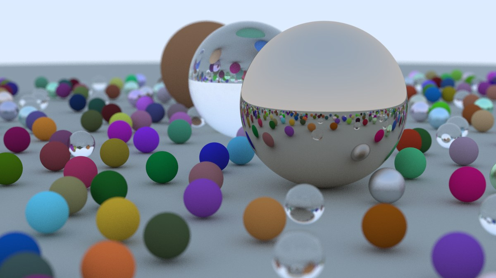
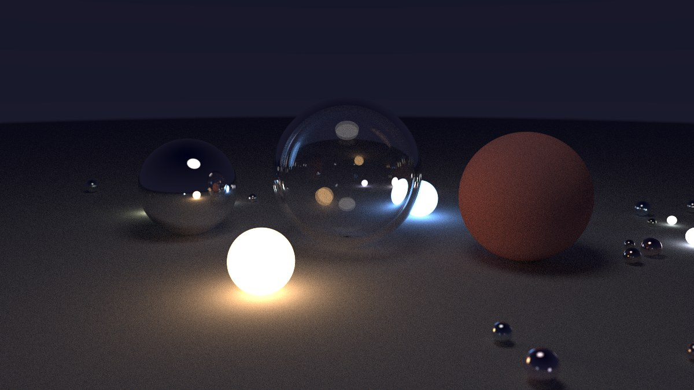
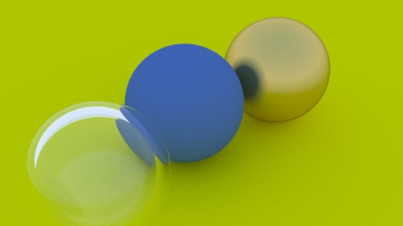

# raytracer

**A multithreaded path tracer in Rust with zero dependencies.**



|  |  |
| --- | --- |
| `night`: every photon comes from an emissive sphere | `glass`: a hollow bubble, matte blue, brushed gold |

Everything here is written from scratch: vector maths, a seedable PCG random
number generator, materials, a thin-lens camera, a bounding volume hierarchy,
the thread pool, and even the **PNG encoder** (CRC-32, Adler-32, zlib framing).

```bash
cargo run --release -- --scene spheres --width 1200 --samples 200 --out spheres.png
cargo run --release -- --scene night --samples 600
cargo run --release -- --scene glass --width 800 --samples 300
```

```text
rendering 'spheres': 1200x675, 200 samples/pixel, 478 spheres, 2 threads
  100% (675/675 rows)
  done in 55.6s (2.91 M camera rays/s)
  wrote spheres.png
```

## What it does

| | |
| --- | --- |
| **Materials** | Lambertian (matte), metal with adjustable fuzz, dielectric glass (refraction, total internal reflection, Schlick's Fresnel approximation), emissive lights |
| **Camera** | Field of view, look-at orientation, thin-lens depth of field |
| **Sampling** | Many random paths per pixel for anti-aliasing, soft shadows and caustics; gamma correction; firefly clamping |
| **Acceleration** | A BVH with front-to-back traversal, about 6x faster than testing every sphere on the main scene |
| **Parallelism** | Every core via `std::thread::scope`, with output that is **bit-identical for any thread count** |
| **Output** | PNG via a ~70-line encoder written from the spec |

## How it works

**Path tracing** ([`render.rs`](src/render.rs)). For each pixel, fire a ray from the
camera and follow it as it bounces. Each surface multiplies the path's
*throughput* by its colour. Light gets added when the path hits an emitter or
escapes to the sky. One path is noise; hundreds averaged together converge to
the image, with soft shadows, colour bleeding and glass caustics falling out of
the physics for free. It's a loop, not recursion, so deep bounces can't
overflow the stack.

**Glass** ([`material.rs`](src/material.rs), [`vec3.rs`](src/vec3.rs)). Snell's
law bends the ray. Past the critical angle there is no refracted ray, only
total internal reflection. Otherwise, Schlick's approximation picks between
reflecting and refracting, which is why glass looks like a mirror at grazing
angles. A sphere with a *negative* radius flips its normals, which turns a
glass ball into a hollow bubble.

**The BVH** ([`geometry.rs`](src/geometry.rs)). The spheres are wrapped in a tree
of axis-aligned boxes, stored in one flat `Vec` with no pointer chasing. A ray that
misses a box skips everything inside it. Measured with
`cargo run --release --example bvh_speedup`:

```text
478 spheres, 200000 rays
  brute force:   201.8 ms  (0.99 M rays/s)
  BVH:            33.4 ms  (5.99 M rays/s)
  speedup:     6.0x
```

Getting there took two fixes that are worth knowing about:

1. **The ground is a sphere of radius 1000.** Wherever it lands in the tree, its
   giant box swallows its siblings, so that whole subtree can never be skipped.
   The builder now gives any object covering over half a node's surface area a
   leaf of its own at that level. A full surface-area-heuristic builder would
   make the same call.
2. **Front-to-back traversal.** At each node, visit the child the ray enters
   first. Once something is hit, any box that *starts* further away is skipped
   without being opened. Before these two changes the BVH was only 3.2x
   faster than brute force; isolating the ground alone briefly made it slower.

**Determinism** ([`render.rs`](src/render.rs)). Threads pull rows from an atomic
counter, so the work balances itself: sky rows are cheap, glass rows aren't.
Each row seeds its own PCG stream from `(seed, row)`, so the image never
depends on which thread rendered which row. A test renders with 1 and 8 threads
and compares the bytes.

**PNG** ([`png.rs`](src/png.rs)). A signature, then `IHDR`, `IDAT` and `IEND` chunks,
each with a CRC-32. The pixels go in a zlib stream made of deflate "stored"
blocks, which hold raw bytes. That keeps the encoder tiny, at the cost of not
compressing. The test walks the chunks, verifies every CRC, and unwraps the
blocks back into the original pixels.

## Tests

```bash
cargo test --release
```

The 14 tests cover vector algebra, reflection, **Snell's law** (checking
`sin θ₁ = n·sin θ₂`), Fresnel reflectance (glass reflects 4% head-on), ray-sphere
hits from outside and inside, **the BVH against brute force on 20,000 random rays**,
the RNG's uniformity and lack of directional bias, CRC-32/Adler-32 against
published values, a full PNG round trip, render determinism across thread
counts, and every scene rendering.

## Credits

The scenes and the overall approach follow Peter Shirley's excellent free book
*Ray Tracing in One Weekend*. The BVH, threading, determinism, emissive night
scene and PNG encoder go beyond it.

## License

MIT
